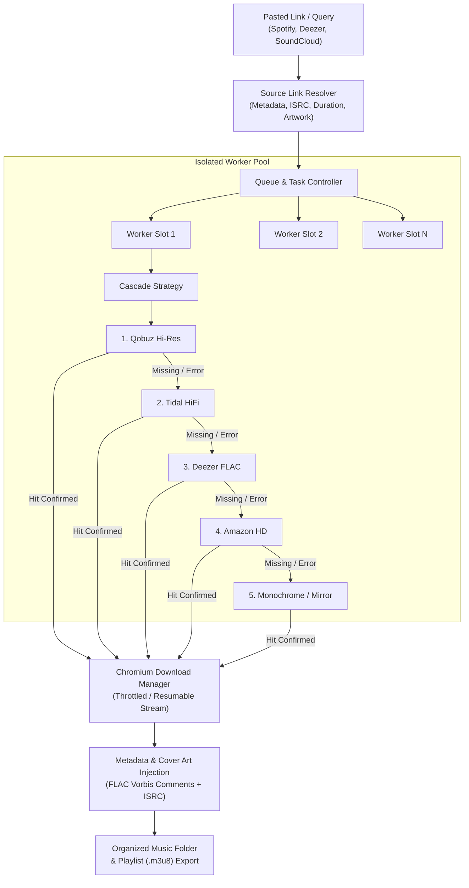

<div align="center">


# LucidaFetcher

**Fast, automated lossless FLAC audio fetcher and library organizer for Windows**

*Automating multi-source cascade scrapers into clean, tagged FLAC downloads — powered by Electron, React 19, and Vite.*

<p>
  <a href="package.json"></a>
  
  
  
  
  
  
  
</p>

---

<p>
  <a href="#-about-lucidafetcher">About</a> •
  <a href="#-key-features">Features</a> •
  <a href="#-supported-services">Supported Services</a> •
  <a href="#-how-it-works">How It Works</a> •
  <a href="#-visual-tour">Visual Tour</a> •
  <a href="#-installation--usage">Installation &amp; Usage</a> •
  <a href="#-architecture">Architecture</a> •
  <a href="#-building-from-source">Building</a> •
  <a href="#-icon--design-philosophy">Design</a> •
  <a href="#-reliability--testing">Reliability</a> •
  <a href="#-license--credits">License</a>
</p>

</div>

---

## 🎧 About LucidaFetcher

**LucidaFetcher** is a desktop audio fetching and cataloging workstation for Windows. It allows you to paste playlist, album, track, or artist profile links from mainstream streaming services and automatically retrieves studio-quality, lossless **FLAC** audio files from high-resolution provider mirrors.

By driving scraper cascades (such as Lucida and Monochrome) through isolated, headless `<webview>` browser contexts, LucidaFetcher bypasses manual browser searches, matches accurate recording releases, downloads audio via Chromium's native transfer pipeline, tags each file with comprehensive Vorbis comments, embeds high-resolution album artwork, and organizes files into clean directory hierarchies.

### Core Principles

- 🪟 **Tailored Windows Desktop Experience**: Available as both a standard NSIS installer (`LucidaFetcher-Setup.exe`) and a standalone portable executable (`LucidaFetcher-Portable.exe`), featuring a persistent system tray icon, Windows notifications, audio cues, and taskbar progress reporting.
- 💎 **Lossless Audio Quality**: Directly retrieves 16-bit / 24-bit lossless FLAC files whenever available, eliminating lossy re-encoding artifacts.
- 🏷️ **Rich Metadata & Embedded Artwork**: Automatically queries and writes artist, title, album, release year, track number, and ISRC tags directly into FLAC Vorbis comments alongside hi-res embedded covers.
- 🛡️ **Zero Telemetry & Private**: All requests originate strictly from your local machine. No external telemetry, tracking pings, or cloud user accounts are involved.
- ⚡ **Resilient Concurrent Engine**: Features a decoupled ESM engine with concurrency controls, speed throttling, automatic transfer resume, and exponential backoff retry mechanisms.

---

## ✨ Key Features

<table>
  <tr>
    <td width="50%">
      <h3>🌊 Intelligent Cascade Fallbacks</h3>
      <p>Automatically chains download attempts across multiple high-res stores (Qobuz &rarr; Tidal &rarr; Deezer &rarr; Amazon Music &rarr; Yandex &rarr; Monochrome). If a track is unavailable or region-locked on one provider, LucidaFetcher seamlessly falls back to the next.</p>
    </td>
    <td width="50%">
      <h3>📁 Smart Organization &amp; M3U8 Export</h3>
      <p>Automatically organizes downloads into custom folder structures (e.g. <code>%Artist%/%Album%/%Track%.flac</code>) and generates synchronized <code>.m3u8</code> playlist files for music managers and mobile players.</p>
    </td>
  </tr>
  <tr>
    <td width="50%">
      <h3>🔁 Resilient "Keep Trying" Engine</h3>
      <p>Configurable background retry engine with exponential backoff (from 30 seconds up to 5 minutes). Automatically re-attempts missing tracks as mirror availability recovers without stalling active downloads.</p>
    </td>
    <td width="50%">
      <h3>⚡ Isolated Worker Pool</h3>
      <p>Download searches execute in isolated, sandboxed background webviews with dedicated worker slots. A track remains pinned to its worker slot throughout its entire cascade lifecycle to prevent context bleed.</p>
    </td>
  </tr>
  <tr>
    <td width="50%">
      <h3>🔍 Unified Input &amp; Profile Ingestion</h3>
      <p>Paste any URL or type plain search queries into a single smart input. Ingest full Spotify public profiles and discographies with automatic deduplication across shared playlists.</p>
    </td>
    <td width="50%">
      <h3>🎛️ Bandwidth &amp; Queue Control</h3>
      <p>Integrated network speed limiter, per-item and batch pause/resume, individual track prioritization, and real-time per-second transfer progress tracking.</p>
    </td>
  </tr>
</table>

---

## 🌐 Supported Services

LucidaFetcher bridges input discovery providers with lossless audio download mirrors:

| Service | Type | Icon | Capabilities |
| :--- | :---: | :---: | :--- |
| **Spotify** | Input Resolver |  | Tracks, Albums, Playlists, and complete User Profiles |
| **Deezer** | Resolver &amp; FLAC Mirror |  | Tracks, Albums, Playlists, Artist discographies &amp; FLAC mirror |
| **Qobuz** | Audio Provider |  | Studio Hi-Res 24-bit lossless FLAC audio mirror |
| **Tidal** | Audio Provider |  | HiFi Lossless FLAC audio mirror |
| **Amazon Music** | Audio Provider |  | HD Lossless FLAC audio mirror |
| **SoundCloud** | Resolver &amp; Stream |  | Direct track and set resolver &amp; stream fetching |
| **Monochrome** | Audio Mirror |  | Lossless FLAC scraper mirror fallback |
| **Yandex Music** | Audio Provider |  | Lossless audio mirror fallback |
| **YouTube** | Fallback Provider |  | Direct audio fallback for rare or unreleased recordings |

---

## 🔄 How It Works



---

## 📸 Visual Tour

### 1. Active Downloads &amp; Live Queue
Monitor active transfers in real time with per-second byte progress, provider source badges, retry states, and comprehensive batch controls.

```
┌──────────────────────────────────────────────────────────────────────────────┐
│  Downloads (12)  │  4 Active  │  6 Completed  │  1 Missing  │  1 Paused     │
├──────────────────────────────────────────────────────────────────────────────┤
│  [Qobuz]  Daft Punk - Giorgio by Moroder                [84% · 3.4 MB/s]    │
│  [Tidal]  The Weeknd - Blinding Lights                  [42% · 2.8 MB/s]    │
│  [Deezer] Arctic Monkeys - Do I Wanna Know?             [Queued]            │
│  [Amazon] Massive Attack - Teardrop                     [Searching...]      │
└──────────────────────────────────────────────────────────────────────────────┘
```

- **Live Transport Bar**: Global Pause, Resume, Clear Finished, and Retry controls.
- **Granular Inspections**: View active provider, matched release, download rate, and elapsed time per item.
- **Safety**: Pausing suspends active Chromium transfers without corrupting partial files.

### 2. Unified Link Ingestion &amp; Profile Ingestion
Paste URLs or search terms without manually toggling input types:

- **Link Mode**: Instantly parses track lists, album sets, and public playlists from Spotify, Deezer, and SoundCloud.
- **Profile Mode**: Ingests entire Spotify user profiles, mapping every public playlist while deduplicating identical tracks across collections.
- **History Tab**: Access recently pasted playlists and re-queue items with one click.

### 3. Engine Settings &amp; Bandwidth Tuning
Fine-tune how LucidaFetcher operates to suit your connection and storage preferences:

- **Worker Concurrency**: Adjust parallel search and download slots (1 to 6 concurrent workers).
- **Download Speed Throttling**: Cap bandwidth consumption to maintain connection headroom.
- **Provider Chain Selection**: Enable, disable, or reorder preferred audio sources.
- **Keep Trying Preference**: Configure background retry intervals and persistence across app restarts.
- **Audio Feedback**: Optional auditory chimes for completed batches and error notifications.

---

## 🚀 Installation &amp; Usage

### Windows Installer

Download the latest installer or portable executable from the releases:

```powershell
# Run the NSIS Installer (configures Start Menu, Desktop shortcuts, and uninstaller)
LucidaFetcher-1.0.0-Setup.exe

# Or run the single-file Portable edition directly
LucidaFetcher-1.0.0-Portable.exe
```

When installed:
- Shortcuts are created on your Desktop and Start Menu.
- Application state (history, download manifest, configuration) is securely saved in `%APPDATA%\LucidaFetcher`.
- Minimized runs remain accessible via the Windows System Tray icon.

### Quick Start Workflow

1. **Launch LucidaFetcher**.
2. Go to **Settings** and choose your preferred **Download Directory** and **Provider Chain**.
3. Switch to **Add music** and paste a Spotify, Deezer, or SoundCloud link into the box.
4. Click **Add to Queue** to initiate the automatic resolver.
5. Watch the **Downloads** view as the cascade worker pool finds, validates, and downloads your lossless FLACs.

---

## 🏗️ Architecture

The codebase enforces a three-tier separation of concerns with a strict boundary between Electron, Node.js, and React:

```
LucidaFetcher/
├── main.js                  # Electron Main Process (OS filesystem, downloads, tray, IPC)
├── src/
│   ├── engine/              # Pure ESM Download Engine (Independent of DOM & Electron)
│   │   ├── controller.mjs   # Queue state machine, retry scheduler & orchestrator
│   │   ├── pool.mjs         # Worker slots & concurrency management
│   │   ├── chain.mjs        # Search attempt plans & fallback strategies
│   │   ├── worker.mjs       # Per-track webview execution lifecycle
│   │   ├── matching.mjs     # Title, artist & duration fuzzy-scoring algorithm
│   │   └── sources.mjs      # Link resolvers (Spotify, Deezer, SoundCloud)
│   └── ui/                  # React 19 Frontend (Built via Vite)
│       ├── App.jsx          # View router, sidebar & transport wrapper
│       ├── views/           # QueueView, AddView, SettingsView
│       └── components/      # TrackRow, TransportBar, SourceIcon
└── scripts/                 # Icon generation, brand marks & smoke checks
```

- **`main.js`**: Controls disk I/O, Chromium `will-download` handlers, byte-range speed throttling, Windows tray lifecycle, single-instance mutex locks, and session JSONL logging.
- **`src/engine/`**: Pure Node ESM download engine. Contains **no React or DOM code**. Injected browser scripts (`cascade-lucida.mjs`, `cascade-monochrome.mjs`) are compiled with zero scope closures to guarantee fault-tolerant injection inside sandboxed `<webview>` tags.
- **`src/ui/`**: Responsive React 19 interface. Synchronizes with the engine controller via `useSyncExternalStore` for flicker-free, 60fps UI rendering.

---

## 🛠️ Building from Source

### Prerequisites

- **Node.js**: v20 or higher
- **npm**: v10 or higher
- **Windows 10/11 x64**
- **ffmpeg** (optional; required only if running the full Electron end-to-end integration test suite)

### Build Instructions

1. **Clone the repository:**
   ```powershell
   git clone https://github.com/projectGloria/LucidaFetcher.git
   cd LucidaFetcher
   ```

2. **Install dependencies:**
   ```powershell
   npm install
   ```

3. **Run the test suite:**
   ```powershell
   npm test
   ```

4. **Start in development mode:**
   ```powershell
   # In terminal 1: run Vite UI dev server
   npm run dev:ui

   # In terminal 2: build UI bundle and start Electron
   npm run build:ui
   npm start
   ```

5. **Package Windows executables:**
   ```powershell
   # Build the NSIS installer and portable executable into release/
   npm run dist:win
   npm run dist:portable
   ```

---

## 🎨 Icon &amp; Design Philosophy

<p align="center">
  
  &nbsp;&nbsp;&nbsp;&nbsp;
  
</p>

> *"The mark: the app's accent violet on a rounded square, with a download arrow whose shaft is three audio bars. It has to survive being 16px in a system tray, so there is exactly one idea in it and no line thinner than a twelfth of the canvas."*

The visual identity of LucidaFetcher is generated entirely in pure mathematical code via [`scripts/make-icon.mjs`](scripts/make-icon.mjs):
- **Deterministic Code Drawing**: Icon bitmaps are created using pure zlib compression and raw CRC calculations—without third-party graphic editors or external image conversion pipelines.
- **Scalability**: The single programmatic vector specification produces both the 512px application icon and the multi-resolution `.ico` container (16px to 256px), ensuring zero pixel drift between the desktop shortcut and the 16px system tray indicator.
- **High-Contrast Silhouette**: Engineered for instant recognition against light and dark Windows taskbars.

---

## 🛡️ Reliability &amp; Testing

LucidaFetcher includes an extensive automated regression test suite ensuring download integrity, state persistence, and error recovery:

- **280+ Passing Unit &amp; Regression Tests**: Validates fuzzy track matching, duration drift tolerances, artist gate filters, rate-limiting, and cascade plan advancement.
- **Atomic Disk Persistence**: Queue state, download manifests, and configuration files are written atomically with a strict quit/flush handshake to eliminate corruption during sudden process termination.
- **Stall &amp; Collision Protection**: Detects stalled transfers (2-minute silence gate), recovers partial streams via HTTP Range requests, and automatically sanitizes reserved Windows filenames (`CON`, `PRN`, `AUX`, `NUL`).
- **Memory &amp; Resource Hygiene**: Active webview contexts, event listeners, and pending timeouts are cleared immediately on item settlement or cancellation.

Run the test suite at any time:

```powershell
npm test
```

---

## 📜 License &amp; Credits

Distributed under the **[ISC License](package.json)**.

- **Brand Trademarks**: Service marks and logos (Spotify, Deezer, Qobuz, Tidal, Amazon Music, SoundCloud, YouTube, Napster, Yandex) are trademarks of their respective owners. Brand icons are CC0 path data provided by [Simple Icons](https://simple-icons.github.io/) and are used solely to indicate audio source compatibility.
- **Audio Integrity**: LucidaFetcher is a client utility that automates personal library organization and metadata tagging. Please respect artist rights and terms of service in your jurisdiction.
